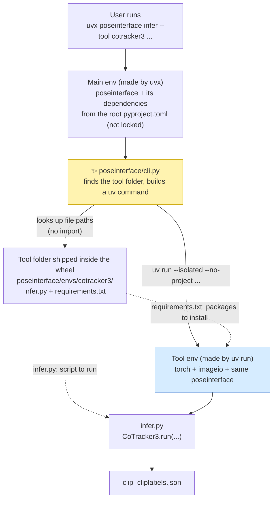
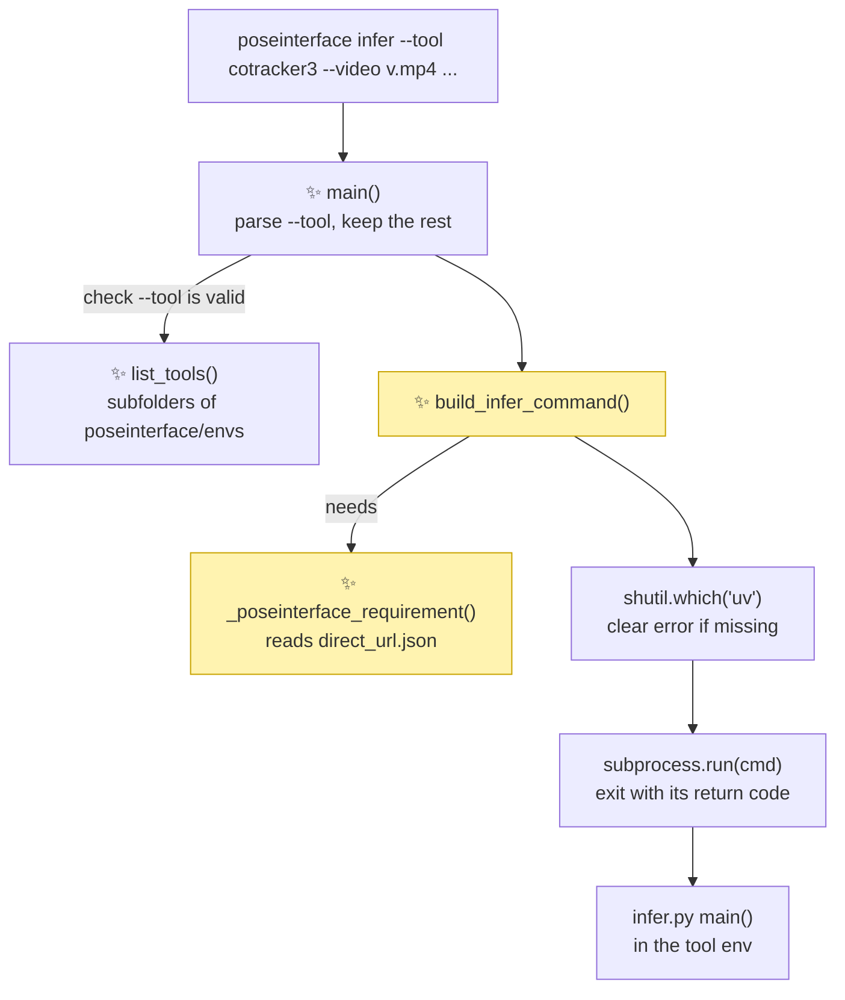

# Proposal for a `poseinterface infer` command that runs each tool in its own environment

## Description

Add a `poseinterface infer --tool <tool>` command to the main package.

The command does not install the tool into the user's environment.
It asks uv to build a separate, throwaway environment for that tool and runs the tool's
`infer.py` inside it.

A user then needs one line and no clone:

```bash
uvx poseinterface infer --tool cotracker3 --video clip.mp4 --startlabels clip_startlabels.json
```

The only thing the user installs is uv.

- `uvx` downloads `poseinterface` from PyPI into a temporary environment that uv caches.
    - That main env gets the `[project] dependencies` of the root `pyproject.toml`.
    - It is not locked: `uvx` picks the newest versions that fit those ranges.
- The dispatcher creates the tool env, with the same `poseinterface` plus torch.
- Until a release on PyPI includes this command, `poseinterface` comes from git instead. This
  needs `git` but still no clone (see [Points to discuss](#points-to-discuss), point 2):

```bash
uvx --from git+https://github.com/neuroinformatics-unit/poseinterface@<branch-or-tag> \
    poseinterface infer --tool cotracker3 --video clip.mp4 --startlabels clip_startlabels.json
```



Solid arrows are the order things happen in when the user runs the command.
Dashed arrows show where each file from the tool folder ends up.

`cli.py` never imports `infer.py`. Importing it in the main env would fail because torch is not
installed there. `cli.py` only looks up the paths of `requirements.txt` and `infer.py` and passes
them to `uv run`.

- *poseinterface/cli.py* (✨ new) → would live in
  [poseinterface/](https://github.com/neuroinformatics-unit/poseinterface/blob/envs-management/poseinterface)
- *Tool folder* → today at
  [envs/cotracker3/](https://github.com/neuroinformatics-unit/poseinterface/tree/envs-management/envs/cotracker3)
- *infer.py* → `main` at
  [infer.py:103](https://github.com/neuroinformatics-unit/poseinterface/blob/envs-management/envs/cotracker3/infer.py#L103)

## References

- [PR #86 comment](https://github.com/neuroinformatics-unit/poseinterface/pull/86#issuecomment-6192393613):
  the "one uv env per tool" design this builds on.
- [#85](https://github.com/neuroinformatics-unit/poseinterface/pull/85): the alternative design
  the comment above replies to.
- Branch `envs-management`: the CoTracker3 prototype
  ([infer.py](https://github.com/neuroinformatics-unit/poseinterface/blob/envs-management/envs/cotracker3/infer.py),
  [pyproject.toml](https://github.com/neuroinformatics-unit/poseinterface/blob/envs-management/envs/cotracker3/pyproject.toml)).
- [trackers.py:22](https://github.com/neuroinformatics-unit/poseinterface/blob/envs-management/poseinterface/trackers.py#L22):
  the `PointTracker` base class that every `infer.py` subclasses.

## Overview of steps

1. Move `envs/` to `poseinterface/envs/` so the tool folders ship inside the wheel.
2. Add a `requirements.txt` to each tool folder, exported from that tool's `uv.lock`.
3. Add `poseinterface/cli.py` with an `infer` subcommand that builds and runs a `uv run` command.
4. Register a `poseinterface` console script in the main `pyproject.toml`.
5. Add unit tests for the command builder, plus one opt-in end-to-end test.
6. Document the one-line usage in the README.

## Key aspects of suggested implementation

### 1. The tool folders must ship inside the wheel

**Constraint:** `uvx poseinterface` installs the wheel from PyPI.
There is no repository on disk, so `infer.py` must be inside the wheel.

**What it forces:**

- setuptools only ships files that live inside a package folder.
    - Today `envs/` sits at the repo root, and
      [MANIFEST.in:10](https://github.com/neuroinformatics-unit/poseinterface/blob/envs-management/MANIFEST.in#L10)
      excludes it.
- So `envs/` moves to `poseinterface/envs/`.
    - `[tool.setuptools.packages.find]` already includes `poseinterface*`
      ([pyproject.toml:80](https://github.com/neuroinformatics-unit/poseinterface/blob/envs-management/pyproject.toml#L80)).
    - `include-package-data = true` is already set
      ([pyproject.toml:78](https://github.com/neuroinformatics-unit/poseinterface/blob/envs-management/pyproject.toml#L78)),
      and setuptools-scm adds every git-tracked file, so `requirements.txt` ships too.
- Each tool's `tests/` folder is left out of the wheel:

```diff
+[tool.setuptools.exclude-package-data]
+"*" = ["tests/*"]
```

The development workflow from the PR #86 comment keeps working.
Only the folder changes, and the local path to `poseinterface` moves up one level:

```diff
 # poseinterface/envs/cotracker3/pyproject.toml
 [tool.uv.sources]
-poseinterface = { path = "../..", editable = true }
+poseinterface = { path = "../../..", editable = true }
```

```bash
uv run --project poseinterface/envs/cotracker3 poseinterface/envs/cotracker3/infer.py --video ...
```

### 2. The tool env is built from `requirements.txt`, not from the tool's `pyproject.toml`

**Constraint:** the tool's `pyproject.toml` points at `poseinterface` with a relative path.

- Inside an installed wheel that path leads into `site-packages`, which is not a project.
    - This is the reason `uv run --project <bundled tool folder>` cannot be used.
- `uv run --project <folder>` also writes `.venv/` and `uv.lock` into `<folder>`, not into the
  current directory (checked with uv 0.13.0).
    - For the bundled tool folder, `<folder>` is inside `site-packages`.
    - `UV_PROJECT_ENVIRONMENT` and `--frozen` would avoid these writes, but not the broken path.

**What it forces:** the command ignores the tool's `pyproject.toml` and uses two inputs instead:

- **The tool's pinned dependencies**, from `requirements.txt`.
    - The file is generated from `uv.lock`, so the versions are the ones developers tested.
    - `poseinterface` is left out of the file.
- **The `poseinterface` that is running the command**, passed separately with `--with`.
    - The tool env then always gets the same `poseinterface` version as the main env.

```bash
uv export --project poseinterface/envs/cotracker3 \
    --no-dev --no-hashes --no-emit-package poseinterface \
    -o poseinterface/envs/cotracker3/requirements.txt
```

> [!NOTE]
> `uv export` writes a `uv.lock` out as a plain `requirements.txt`. The lock is universal, so the
> exported file keeps the per-platform markers (for example, different wheels on macOS and Linux).

### 3. The command that runs the tool

The dispatcher builds this command and runs it with `subprocess.run`:

```bash
uv run --isolated --no-project --python 3.12 \
    --with-requirements <tool folder>/requirements.txt \
    --with "<poseinterface requirement>" \
    python <tool folder>/infer.py --video ... --startlabels ...
```

- `--no-project`: do not look for a `pyproject.toml`.
- `--isolated`: build a fresh environment that does not reuse the main env's packages.
- `--python`: the same minor version as the main env.
- uv caches the environment, so only the first run downloads torch.

All flags above exist in uv 0.13.0 (checked with `uv run --help`).

The `<poseinterface requirement>` depends on how the main env got `poseinterface`:

| How `poseinterface` was installed | Requirement passed to `--with` |
|---|---|
| From PyPI (`uvx poseinterface`) | `poseinterface==<installed version>` |
| From git (`uvx --from git+https://...`) | `poseinterface @ git+https://...@<commit>` |
| Editable clone (development) | `--with-editable <repo root>` |

The dispatcher reads the install source from the package's `direct_url.json` file.

> [!NOTE]
> `direct_url.json` is a standard file that pip and uv write next to an installed package. It
> records the URL or local path the package came from. PyPI installs do not have one.

### 4. Arguments pass straight through to `infer.py`

The dispatcher only reads `--tool`.

- Every other argument goes unchanged to the tool's `infer.py`.
- `infer.py` already validates the arguments shared by all trackers
  ([infer.py:77](https://github.com/neuroinformatics-unit/poseinterface/blob/envs-management/envs/cotracker3/infer.py#L77)).
- `--tool` choices are the subfolders of `poseinterface/envs/`, so a new tool needs no change
  to `cli.py`.

```python
def main(argv: list[str] | None = None) -> None:
    """Entry point for the ``poseinterface`` console script."""
    ...


def build_infer_command(tool: str, tool_args: list[str]) -> list[str]:
    """Return the ``uv run`` command that runs ``<tool>/infer.py``."""
    ...


def list_tools() -> list[str]:
    """Return the tool folders shipped in ``poseinterface/envs``."""
    ...
```

## Detailed implementation



Arrows are calls, in the order they happen.

- *infer.py main()* →
  [infer.py:103](https://github.com/neuroinformatics-unit/poseinterface/blob/envs-management/envs/cotracker3/infer.py#L103)
- All ✨ boxes are new functions in `poseinterface/cli.py`.

| # | Change | Signature or diff |
|---|---|---|
| 1 | Move `envs/` → `poseinterface/envs/` | `git mv envs poseinterface/envs` |
| 2 | Fix the local path in the tool's `pyproject.toml` | `path = "../../.."` |
| 3 | Export `requirements.txt` per tool | `uv export ... -o requirements.txt` |
| 4 | New `poseinterface/cli.py` | `main`, `list_tools`, `build_infer_command`, `_poseinterface_requirement` |
| 5 | Register the console script | `poseinterface = "poseinterface.cli:main"` |
| 6 | Keep tool tests out of the wheel | `[tool.setuptools.exclude-package-data]` |
| 7 | Update `MANIFEST.in` | drop `recursive-exclude envs *`, add `recursive-exclude poseinterface/envs/*/tests *` |

<details><summary><b>Step 4: <code>cli.py</code> in pseudocode</b></summary>

```python
ENVS_DIR = Path(__file__).parent / "envs"

def list_tools():
    RETURN sorted(names of subfolders of ENVS_DIR that contain infer.py)

def _poseinterface_requirement():
    dist = importlib.metadata.distribution("poseinterface")
    direct_url = dist.read_text("direct_url.json")
    IF direct_url is None:                      # installed from PyPI
        RETURN ["--with", f"poseinterface=={dist.version}"]
    info = json.loads(direct_url)
    IF info has "vcs_info":                     # installed from git
        RETURN ["--with", f"poseinterface @ git+{info['url']}@{info['vcs_info']['commit_id']}"]
    IF info["dir_info"].get("editable"):        # development clone
        RETURN ["--with-editable", path from info["url"]]
    RETURN ["--with", path from info["url"]]    # local, non-editable

def build_infer_command(tool, tool_args):
    tool_dir = ENVS_DIR / tool
    RETURN [
        "uv", "run", "--isolated", "--no-project",
        "--python", f"{sys.version_info.major}.{sys.version_info.minor}",
        "--with-requirements", str(tool_dir / "requirements.txt"),
        *_poseinterface_requirement(),
        "python", str(tool_dir / "infer.py"), *tool_args,
    ]

def main(argv=None):
    parser with subcommand "infer" and option --tool (choices=list_tools())
    args, tool_args = parser.parse_known_args(argv)
    IF shutil.which("uv") is None:
        exit with "poseinterface infer needs uv: https://docs.astral.sh/uv/"
    exit with subprocess.run(build_infer_command(args.tool, tool_args)).returncode
```

</details>

<details><summary><b>Rejected alternatives</b></summary>

| Alternative | Why worse |
|---|---|
| `uv run --project <bundled tool folder>` | The relative `poseinterface` path breaks inside `site-packages`. It also writes `.venv/` and `uv.lock` into the project folder, which is inside `site-packages`. |
| Dispatcher calls `uvx --from git+...#subdirectory=envs/<tool>` | Needs git and network on every new version. The wrapper version can drift from the installed `poseinterface`. |
| Install every tool into the main env as optional extras | Brings back the dependency conflicts that one env per tool avoids. |
| Plain `python -m venv` plus `pip install` | Slower, and gets no shared uv cache, so torch downloads again for each env. |
| Add `uv` as a Python dependency of `poseinterface` | Not needed for `uvx` users, who have uv already. See [Points to discuss](#points-to-discuss). |

</details>

## Files changed

| File | Change |
|---|---|
| `envs/` → `poseinterface/envs/` | moved |
| `poseinterface/envs/cotracker3/pyproject.toml` | local path to `poseinterface` becomes `../../..` |
| `poseinterface/envs/cotracker3/requirements.txt` | **new**, exported from `uv.lock` |
| `poseinterface/cli.py` | **new**, the `infer` dispatcher |
| `pyproject.toml` | `poseinterface` console script; `exclude-package-data` for tool tests |
| `MANIFEST.in` | exclude rules follow the new folder |
| `.pre-commit-config.yaml` | keep `requirements.txt` in sync with `uv.lock` (see [Points to discuss](#points-to-discuss)) |
| `tests/test_unit/test_cli.py` | **new** |
| `tests/test_integration/test_cli_infer.py` | **new**, opt-in |
| `README.md` | one-line usage |

## Tests

Yes, tests are needed: `build_infer_command` and `_poseinterface_requirement` hold all the logic.

**Unit** (`tests/test_unit/test_cli.py`, main env, no network):

- `list_tools()` returns `["cotracker3"]`.
- `build_infer_command("cotracker3", ["--video", "v.mp4"])` ends with
  `python <...>/cotracker3/infer.py --video v.mp4`.
- `_poseinterface_requirement()` gives the right flags for each install type.
    - Patch `importlib.metadata.distribution` to return fake `direct_url.json` contents
      (none, git, editable).
- `main(["infer", "--tool", "nope"])` exits with an argparse error.
- `main` exits with a clear message when `shutil.which("uv")` returns `None`.
- The built wheel contains `poseinterface/envs/cotracker3/infer.py` and `requirements.txt`, and
  no `tests/`.
    - Build with `uv build --wheel` into `tmp_path`, then list it with `zipfile`.

**Integration** (`tests/test_integration/test_cli_infer.py`, opt-in, downloads torch and the model):

- Run `poseinterface infer --tool cotracker3` on the clip in
  `tests/data/Train/SWC-plusmaze/.../Clips/` and check that `*_cliplabels.json` is written.
    - Needs a `*_startlabels.json` for that clip. None exists in `tests/data` yet.

## Documentation updates

Yes:

- `README.md`: the one-line `uvx poseinterface infer ...` usage.
- `poseinterface/envs/cotracker3/README.md` (empty today): the development command and how to
  regenerate `requirements.txt`.

## Verifications for agent to run

```bash
uv run pytest tests/test_unit/test_cli.py -v
uv run pre-commit run --all-files                 # includes check-manifest

# The wheel contains the tool folder and no tool tests
uv build --wheel -o "$TMPDIR/dist" && unzip -l "$TMPDIR"/dist/*.whl | grep envs/

# End to end from a clean tool env, using the local checkout as the source
uvx --from . poseinterface infer --tool cotracker3 \
    --video <clip.mp4> --startlabels <clip_startlabels.json> --output-dir "$TMPDIR/out"

# The development workflow still works
uv run --project poseinterface/envs/cotracker3 pytest poseinterface/envs/cotracker3/tests
```

## Gotchas

| Detail | Consequence | Handling |
|---|---|---|
| `requirements.txt` gets out of sync with `uv.lock` | Users run different versions from the ones developers tested | A pre-commit hook re-exports it (see [Points to discuss](#points-to-discuss)) |
| `poseinterface/envs/*/infer.py` imports `torch` | mypy in pre-commit and any `import poseinterface.envs...` in the main env fail | Exclude `poseinterface/envs/` from mypy; never import tool code from the main package |
| `poseinterface==<version>` must exist on PyPI | A development version such as `0.1.dev5+g1c7d8f5` from a wheel built locally cannot be found | Covered by the git and editable cases of `_poseinterface_requirement` |
| The first run downloads torch and the model weights | The first run takes minutes; later runs are fast | Say so in the README |

## Points to discuss

| # | To discuss | Conclusion |
|---|---|---|
| 1 | **Move `envs/` into the package?** It is needed to ship the tool folders in the wheel, but it changes the layout from the PR #86 comment. Recommend moving it: the only other way is a custom build step that copies `envs/` into the wheel. | |
| 2 | **When to release.** Tagged releases publish to PyPI ([test_and_deploy.yml](https://github.com/neuroinformatics-unit/poseinterface/blob/envs-management/.github/workflows/test_and_deploy.yml#L49)). The latest is 0.2.0, which has neither `trackers.py` nor the `poseinterface` command. Until the next release, the one-liner is `uvx --from git+https://github.com/neuroinformatics-unit/poseinterface@<branch-or-tag> poseinterface infer ...`. Recommend a release once this PR merges, so the short `uvx poseinterface ...` works. | |
| 3 | **PyTorch build per platform.** `uv run` has no `--torch-backend` flag (checked in uv 0.13.0), so the tool env takes torch from PyPI. On Linux the PyPI build already supports CUDA, which may be enough. Not checked: whether `uv export` keeps a custom PyTorch index in `requirements.txt`. Recommend PyPI torch for now. | |
| 4 | **Keeping `requirements.txt` in sync.** Recommend the `uv-export` hook from `astral-sh/uv-pre-commit`, one entry per tool. Not checked yet against that repo's current release. | |
| 5 | **Require `uv` on `PATH`, or depend on the `uv` package?** Recommend requiring it on `PATH`: `uvx` users have it already, and the error message names the install page. | |
| 6 | **A `train` subcommand.** It would reuse `build_infer_command` with `train.py`. Recommend a separate PR once a tool has a `train.py`. | |
| 7 | **Pass `--tool all`?** Looping over every tool is the goal in the PR #86 comment. Recommend leaving it out: a shell loop over `list_tools()` output does the same for now. | |
| 8 | **Which lock format the dispatcher installs from.** All three options below pin the same versions from `uv.lock`. Recommend `requirements.txt`: it is the only one that works with a single `uv run`. See the comparison below this table. | |
| 9 | **Install `poseinterface` in the tool env from PyPI instead of a local path?** A PyPI source would make `uv run --project <bundled tool folder> --frozen` work, with no `requirements.txt` to export. Recommend keeping the local path for now, for the reasons below this table. Revisit once `PointTracker` is stable. | |

<details><summary><b>Point 8: <code>requirements.txt</code> vs <code>pylock.toml</code> vs <code>uv.lock</code></b></summary>

All three were tried on the cotracker3 lock with uv 0.13.0.

| Format | How the dispatcher uses it | Works with `uv run --with-requirements`? | Why worse |
|---|---|---|---|
| `requirements.txt` (recommended) | `uv export` from `uv.lock`; one `uv run` call | Yes | Needs a pre-commit hook to stay in sync with `uv.lock` |
| `pylock.toml` | `uv export --format pylock.toml` from `uv.lock`; then `uv venv` + `uv pip sync pylock.toml` + run | **No.** It reads zero requirements and gives no error, so the tool env has no torch | Three uv calls and a venv folder to manage; needs the same sync hook as `requirements.txt` |
| `uv.lock` directly | Copy the tool folder to a cache folder; `uv sync --frozen --no-install-package poseinterface`; `uv pip install` poseinterface; run | No (only `uv sync` installs from a lock outside a project) | Three uv calls and a cache folder to manage; not tested whether `--frozen` skips the broken `../..` path |

> [!NOTE]
> `pylock.toml` is the standard lockfile format from PEP 751. Any installer can read it, unlike
> `uv.lock`, which only uv reads. `uv pip install -r pylock.toml` and `uv pip sync pylock.toml`
> both read the full package list of the cotracker3 lock (225 packages).

</details>

<details><summary><b>Point 9: <code>poseinterface</code> from a local path vs from PyPI</b></summary>

Today the tool's `pyproject.toml` installs `poseinterface` from the local repo:

```toml
[tool.uv.sources]
poseinterface = { path = "../..", editable = true }
```

Reasons to keep the local path for now:

- **The released version lacks the code the wrapper needs.**
    - The latest release on PyPI is 0.2.0.
    - `poseinterface/trackers.py`, which holds `PointTracker`, was added after v0.2.0.
    - So with a PyPI source, `from poseinterface.trackers import PointTracker` fails.
- **The lock would pin an older `poseinterface` than the one running the dispatcher.**
    - The tool's `uv.lock` in release 0.3.0 cannot pin 0.3.0: that version is not on PyPI until
      the release is published.
    - So the tool env would run the previous release's `PointTracker` and `write_cliplabels`.
- **Development gets slower.**
    - With `editable = true`, a change to `trackers.py` shows up straight away in the tool env.
    - With a PyPI source, each such change needs a release first.

What a PyPI source would give:

- `uv run --project <bundled tool folder> --frozen` works, with `UV_PROJECT_ENVIRONMENT` set to
  a cache folder.
- The dispatcher installs straight from `uv.lock`, with no `requirements.txt` and no sync hook.

</details>
