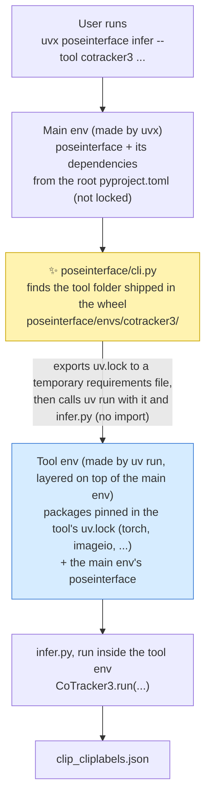
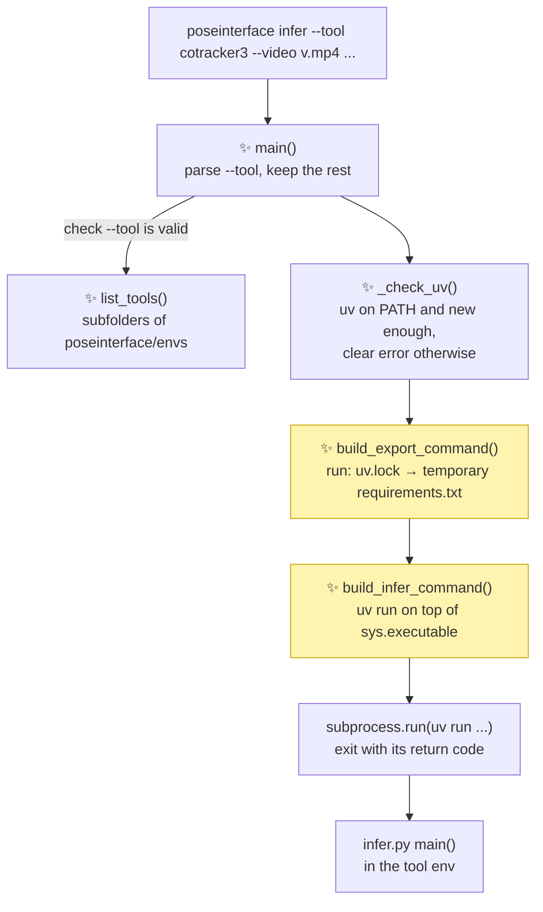

# Proposal for a `poseinterface infer` command that runs each tool in its own environment

## Description

Add a `poseinterface infer --tool <tool>` command to the main package.

The command does not install the tool into the user's environment.
It asks uv to build a separate, throwaway environment for that tool and runs the tool's
`infer.py` inside it.

A user then needs one line and no clone:

```bash
uvx poseinterface infer --tool cotracker3 --video clip.mp4 --startlabels clip_startlabels.json
```

The only thing the user installs is uv.

- `uvx` downloads `poseinterface` from PyPI into a temporary environment that uv caches.
    - That main env gets the `[project] dependencies` of the root `pyproject.toml`.
    - It is not locked: `uvx` picks the newest versions that fit those ranges.
- The dispatcher creates the tool env on top of the main env, so it uses the same
  `poseinterface`, plus torch and the other packages pinned in the tool's `uv.lock`.
- Until a release on PyPI includes this command, `poseinterface` comes from git instead. This
  needs `git` but still no clone (see [Points to discuss](#points-to-discuss), point 2):

```bash
uvx --from git+https://github.com/neuroinformatics-unit/poseinterface@<branch-or-tag> \
    poseinterface infer --tool cotracker3 --video clip.mp4 --startlabels clip_startlabels.json
```



Arrows are the order things happen in when the user runs the command.
The exact `uv run` command is in [section 3](#3-the-commands-to-create-the-tool-env).

`cli.py` never imports `infer.py`. Importing it in the main env would fail because torch is not
installed there. `cli.py` only passes the paths of the tool's `uv.lock` and `infer.py` to uv.

- *poseinterface/cli.py* (✨ new) → would live in
  [poseinterface/](https://github.com/neuroinformatics-unit/poseinterface/blob/envs-management/poseinterface)
- *Tool folder* → today at
  [envs/cotracker3/](https://github.com/neuroinformatics-unit/poseinterface/tree/envs-management/envs/cotracker3)
- *infer.py* → `main` at
  [infer.py:103](https://github.com/neuroinformatics-unit/poseinterface/blob/envs-management/envs/cotracker3/infer.py#L103)

## References

- [PR #86 comment](https://github.com/neuroinformatics-unit/poseinterface/pull/86#issuecomment-6192393613):
  the "one uv env per tool" design this builds on.
- [#85](https://github.com/neuroinformatics-unit/poseinterface/pull/85): the alternative design
  the comment above replies to.
- Branch `envs-management`: the CoTracker3 prototype
  ([infer.py](https://github.com/neuroinformatics-unit/poseinterface/blob/envs-management/envs/cotracker3/infer.py),
  [pyproject.toml](https://github.com/neuroinformatics-unit/poseinterface/blob/envs-management/envs/cotracker3/pyproject.toml)).
- [trackers.py:22](https://github.com/neuroinformatics-unit/poseinterface/blob/envs-management/poseinterface/trackers.py#L22):
  the `PointTracker` base class that every `infer.py` subclasses.

## Overview of steps

1. Move `envs/` to `poseinterface/envs/` so the tool folders ship inside the wheel.
2. Commit each tool's `uv.lock`. Today `.gitignore` ignores every `uv.lock`.
3. Add `poseinterface/cli.py` with an `infer` subcommand. It exports the tool's `uv.lock` to a
   temporary requirements file, then runs `infer.py` with `uv run`.
4. Register a `poseinterface` console script in the main `pyproject.toml`.
5. Add unit tests for the command builders, plus one opt-in end-to-end test.
6. Document the one-line usage in the README.

## Key aspects of suggested implementation

### 1. The tool folders must ship inside the wheel

**Constraint:** `uvx poseinterface` installs the wheel from PyPI.
There is no cloned repository on disk, so `infer.py` must be inside the wheel.

**What it forces:**

- setuptools only ships files that live inside a package folder.
    - Today `envs/` sits at the repo root, and
      [MANIFEST.in:10](https://github.com/neuroinformatics-unit/poseinterface/blob/envs-management/MANIFEST.in#L10)
      excludes it.
- So `envs/` moves to `poseinterface/envs/`.
    - `[tool.setuptools.packages.find]` already includes `poseinterface*`
      ([pyproject.toml:80](https://github.com/neuroinformatics-unit/poseinterface/blob/envs-management/pyproject.toml#L80)).
    - `include-package-data = true` is already set
      ([pyproject.toml:78](https://github.com/neuroinformatics-unit/poseinterface/blob/envs-management/pyproject.toml#L78)),
      and setuptools-scm adds every git-tracked file, so the tool's `pyproject.toml` and
      `uv.lock` ship too (once `uv.lock` is committed, see section 2).
- Each tool's `tests/` folder is left out of the wheel:

```diff
+[tool.setuptools.exclude-package-data]
+"*" = ["tests/*"]
```

Because the folder changes, the local path to `poseinterface` moves up one level:

```diff
 # poseinterface/envs/cotracker3/pyproject.toml
 [tool.uv.sources]
-poseinterface = { path = "../..", editable = true }
+poseinterface = { path = "../../..", editable = true }
```

Then the development workflow from the PR #86 comment keeps working.
```bash
uv run --project poseinterface/envs/cotracker3 poseinterface/envs/cotracker3/infer.py --video ...
```

### 2. The tool env is built from the tool's exported `uv.lock`

The tool env is built from the tool's `uv.lock`, rather than using the tool folder as a uv project.


**Why**

If we use the tool folder as a `uv` project, we rely on the tool's `pyproject.toml`. There the `poseinterface` dependency can be written as:
1. a relative path
2. from PyPI

If we define `poseinterface` using a relative path (case 1):
- In a clone, `../../..` points to the repo root -- this works.
- In an installed wheel, `../../..` points to `site-packages/`, which has no `pyproject.toml`,
  so uv cannot install `poseinterface` from it. -- this does not work

If we define `poseinterface` from PyPI (case 2) two problems remain:

- **The tool env gets an older `poseinterface` than the main env (not fixable).**
  - The tool's lock can only pin a
  version already on PyPI. So release 0.3.0 would run the 0.2.0 `poseinterface` in the tool env.
  - In development, the main env runs the working/editable copy, and the tool env runs the last release.
  - This may be acceptable once `PointTracker` stops changing, but still seems cumbersome. See
    [Points to discuss](#points-to-discuss), point 9.


- **uv still writes into the tool folder (fixable).**
  - `uv run --project <folder>` creates `.venv/` in `<folder>`, which is under `site-packages`, not in the current directory (checked with uv 0.13.0).
  - Because `<folder>` is inside `site-packages`:
    - it may not be writable (for example, a shared conda env or a Docker image);
    - it hides several GB of torch inside another package's install folder, where users
      won't find or manage it;
    - it goes against convention: installed package files should only change on install or upgrade.
      - `uv run --project <folder>` may also overwrite `uv.lock` under `site-packages` which also goes against convention

  A possible workaround for this would be:
  - `UV_PROJECT_ENVIRONMENT=<cache folder>` puts the env outside the tool folder, and
  - `--frozen` installs from the `uv.lock` in the tool folder as it is, without rewriting it.

> [!NOTE]
> If we define `poseinterface` from git (case 3, unmentioned), the result is the same as with PyPI:
>  - `uv.lock` pins a specific commit. A commit cannot contain its own hash, so the lock always
    pins an earlier commit, and the tool env again gets an older `poseinterface` than the main env.
>  - `uv run --project` still writes into the tool folder inside `site-packages`.
>  - In addition, every first run needs `git` and network access to fetch that commit.


In any case, neither setting the source of `poseinterface` as the relative path nor from PyPI  work with `uv run --project`. The relative path breaks in an installed wheel, and a PyPI source gives the tool env an older `poseinterface`.

**Alternative**

Instead, we can run `uv run --no-project` specifying that we want:
- **the `poseinterface` that is running the command**
  - `uv run` builds the tool env on top of the main env's interpreter, so the tool env sees
    the main env's packages, including `poseinterface`.
  - The tool env then always gets the same `poseinterface` as the main env, however it was
    installed (PyPI, git, editable clone, local folder or wheel file).
- **the tool's dependencies**, from the tool's committed `uv.lock`
    - The versions are the ones developers tested.
    - On each run, the dispatcher **exports the lock to a temporary requirements file**.
      - This is because `uv run` cannot read a `uv.lock` directly without a project, only a `requirements.txt` file.
    - `poseinterface` is **left out** of the export
      - This is to ensure we use the same `poseinterface` version in the "tool" and the "main" env.
      - Also because the `poseinterface` line would be a relative editable path (`-e ../../../`), which would be broken for an installed wheel.


> [!IMPORTANT]
> Today the tool's `uv.lock` is not committed:
> [.gitignore:83](https://github.com/neuroinformatics-unit/poseinterface/blob/envs-management/.gitignore#L83)
> ignores every `uv.lock`.
> Each developer then has their own lock, so there is no shared set of tested versions, and
> setuptools-scm leaves the lock out of the wheel. The tool locks must be committed, while the
> root `uv.lock` can stay ignored:
>
> ```diff
>  # uv
>  uv.lock
> +!poseinterface/envs/*/uv.lock
>  .venv/
> ```

> [!NOTE]
> `uv export` writes a `uv.lock` out as a plain `requirements.txt`. The lock is universal, so the
> exported file keeps the per-platform markers (for example, different wheels on macOS and Linux).

### 3. The commands to create the tool env

The dispatcher runs two commands with `subprocess.run`, inside a temporary folder that is
deleted afterwards:

```bash
# 1. uv.lock → requirements file
uv export --project <tool folder> --frozen --offline \
    --no-dev --no-hashes --no-emit-project --no-emit-package poseinterface \
    -o <temporary folder>/requirements.txt

# Flags:
# - `--project <tool folder>`: export the `uv.lock` in that folder. `uv export` has no
#   lockfile argument, so this is how the lock is chosen.
# - `--frozen`: read `uv.lock` as it is. uv does not re-resolve or rewrite it, so it never
#   reads the relative `poseinterface` path and writes nothing into the tool folder.
# - `--offline`: no network needed. The export only reads the lock.
# - `--no-dev`: leave out the `dev` dependency group (`pytest`).
# - `--no-hashes`: leave out the `--hash=...` lines. The lock already pins exact versions
#   (not tested whether the layered `uv run` below works with hashes).
# - `--no-emit-project`: leave out the tool project itself (for example `cotracker3`).
#   It is not emitted today because it is a virtual project, so this only guards against
#   someone later adding a `[build-system]` to the tool's `pyproject.toml`.
# - `--no-emit-package poseinterface`: leave out `poseinterface`. Its line would be a
#   relative editable path, broken in an installed wheel, and the tool env gets the main
#   env's `poseinterface` from the layer below instead.
# - `-o`: write the result to the temporary requirements file.


# 2. Build the tool env on top of the main env and run infer.py in it
uv run --no-project --python <main env's python> \
    --with-requirements <temporary folder>/requirements.txt \
    python <tool folder>/infer.py --video ... --startlabels ...
```

Flags of the `uv run` command:

- `--no-project`: do not look for a `pyproject.toml`.
- `--python <main env's python>`: the main env's interpreter (`sys.executable` in `cli.py`).
- `--with-requirements`: install the exported lock into a temporary env layered on top of
  the main env.
- No `--isolated`: with it, uv would build the env from scratch and not see the main env's
  `poseinterface`.
- No `--with poseinterface`: a bare name resolves against PyPI, so it gives the latest
  release, not the `poseinterface` that is running.

How the layering behaves (tested on small packages with uv 0.13.0, not yet on the
cotracker3 lock):

| Check | Result |
|---|---|
| Can the tool env can import the main env's packages? | Yes, from the main env's `site-packages` |
| Does the main env change? | No, the lock's packages are not installed into it |
| Do the main env and the lock pin different versions of a package? | The tool env sees the lock's version; the main env keeps its own |

> [!NOTE]
> The tool env is less isolated than one built with `--isolated`. Packages in the main env that
> the lock does not cover stay importable in the tool env. Where both have a package, the lock's
> version wins. The main env holds only `poseinterface` and its dependencies, and the lock
> pins those too, because they are dependencies of the tool.

### 4. The dispatcher in `cli.py`

With this command:
```
uvx poseinterface infer --tool cotracker3 --video clip.mp4 --startlabels clip_startlabels.json
```
The dispatcher only reads `--tool` to decide which tool folder to use, and passes every other argument through untouched to the tool's `infer.py`.

`--tool` choices are the subfolders of `poseinterface/envs/`, so a new tool needs no change
  to `cli.py`.


A rough draft of the dispatcher module below:
```python
# poseinterface/cli.py
def main(argv: list[str] | None = None) -> None:
    """Entry point for the ``poseinterface`` console script."""
    ...


def build_export_command(tool: str, output: Path) -> list[str]:
    """Return the ``uv export`` command that writes ``<tool>/uv.lock`` to ``output``."""
    ...


def build_infer_command(
    tool: str, requirements: Path, tool_args: list[str]
) -> list[str]:
    """Return the ``uv run`` command that runs ``<tool>/infer.py``."""
    ...


def list_tools() -> list[str]:
    """Return the tool folders shipped in ``poseinterface/envs``."""
    ...

def _check_uv():
    IF shutil.which("uv") is None:
        exit with "poseinterface infer needs uv: https://docs.astral.sh/uv/"
    version = parse output of ["uv", "--version"]
    IF version < MIN_UV_VERSION:
        exit with f"poseinterface infer needs uv >= {MIN_UV_VERSION}, found {version}"
```

<details><summary><b><code>cli.py</code> in pseudocode</b></summary>

```python
ENVS_DIR = Path(__file__).parent / "envs"
MIN_UV_VERSION = "<version that wrote the committed locks>"   # see Points to discuss, point 10

def list_tools():
    RETURN sorted(names of subfolders of ENVS_DIR that contain infer.py and uv.lock)

def _check_uv():
    IF shutil.which("uv") is None:
        exit with "poseinterface infer needs uv: https://docs.astral.sh/uv/"
    version = parse output of ["uv", "--version"]
    IF version < MIN_UV_VERSION:
        exit with f"poseinterface infer needs uv >= {MIN_UV_VERSION}, found {version}"

def build_export_command(tool, output):
    RETURN [
        "uv", "export", "--project", str(ENVS_DIR / tool),
        "--frozen", "--offline", "--no-dev", "--no-hashes",
        "--no-emit-project", "--no-emit-package", "poseinterface",
        "-o", str(output),
    ]

def build_infer_command(tool, requirements, tool_args):
    RETURN [
        "uv", "run", "--no-project",
        "--python", sys.executable,             # layer on top of the main env
        "--with-requirements", str(requirements),
        "python", str(ENVS_DIR / tool / "infer.py"), *tool_args,
    ]

def main(argv=None):
    parser with subcommand "infer" and option --tool (choices=list_tools())
    args, tool_args = parser.parse_known_args(argv)
    _check_uv()
    WITH tempfile.TemporaryDirectory() as tmp:
        requirements = Path(tmp) / "requirements.txt"
        subprocess.run(build_export_command(args.tool, requirements), check=True)
        result = subprocess.run(build_infer_command(args.tool, requirements, tool_args))
    exit with result.returncode
```

</details>

## Detailed implementation



Arrows are calls, in the order they happen.

- *infer.py main()* →
  [infer.py:103](https://github.com/neuroinformatics-unit/poseinterface/blob/envs-management/envs/cotracker3/infer.py#L103)
- All ✨ boxes are new functions in `poseinterface/cli.py`.

| # | Change | Signature or diff |
|---|---|---|
| 1 | Move `envs/` → `poseinterface/envs/` | `git mv envs poseinterface/envs` |
| 2 | Fix the local path in the tool's `pyproject.toml` | `path = "../../.."` |
| 3 | Commit each tool's `uv.lock` | `.gitignore`: add `!poseinterface/envs/*/uv.lock`; `git add poseinterface/envs/*/uv.lock` |
| 4 | New `poseinterface/cli.py` | Includes `main`, `list_tools`, `_check_uv`, `build_export_command`, `build_infer_command` |
| 5 | Register the console script | `poseinterface = "poseinterface.cli:main"` |
| 6 | Keep tool tests out of the wheel | `[tool.setuptools.exclude-package-data]` |
| 7 | Update `MANIFEST.in` | drop `recursive-exclude envs *`, add `recursive-exclude poseinterface/envs/*/tests *` |
| 8 | Check the tool locks match their `pyproject.toml` | `uv-lock` pre-commit hook, or `uv lock --check`, per tool |


<details><summary><b>Rejected alternatives</b></summary>

| Alternative | Why worse |
|---|---|
| `uv run --project <bundled tool folder>` | The relative `poseinterface` path breaks inside `site-packages`. It also writes `.venv/` and `uv.lock` into the project folder, which is inside `site-packages`. |
| Commit a `requirements.txt` per tool, exported ahead of time from `uv.lock` | Two files with the same pins that must be kept in sync, which needs a pre-commit hook. If someone skips the hook, users get versions nobody tested. Saves only one fast, offline `uv export` call per run. |
| Dispatcher calls `uvx --from git+...#subdirectory=envs/<tool>` | Needs git and network on every new version. The wrapper version can drift from the installed `poseinterface`. |
| Install every tool into the main env as optional extras | Brings back the dependency conflicts that one env per tool avoids. |
| Plain `python -m venv` plus `pip install` | Slower, and gets no shared uv cache, so torch downloads again for each env. |
| `uv run --isolated` with `--with <poseinterface requirement>`, rebuilt from `direct_url.json` | Needs a branch per install type (PyPI, git, editable, local folder, wheel file), and a PyPI pin fails for a mirror or private index that `uv run` cannot see. A bare `--with poseinterface` gives the latest PyPI release, not the running one. Fully isolated, though. |
| Add `uv` as a Python dependency of `poseinterface` | Not needed for `uvx` users, who have uv already. See [Points to discuss](#points-to-discuss). |

</details>

## Files changed

| File | Change |
|---|---|
| `envs/` → `poseinterface/envs/` | moved |
| `poseinterface/envs/cotracker3/pyproject.toml` | local path to `poseinterface` becomes `../../..` |
| `poseinterface/envs/cotracker3/uv.lock` | **newly committed** (exists locally today, but ignored) |
| `.gitignore` | stop ignoring the tool locks: `!poseinterface/envs/*/uv.lock` |
| `poseinterface/cli.py` | **new**, the `infer` dispatcher |
| `pyproject.toml` | `poseinterface` console script; `exclude-package-data` for tool tests |
| `MANIFEST.in` | exclude rules follow the new folder |
| `.pre-commit-config.yaml` | check each tool's `uv.lock` matches its `pyproject.toml` (see [Points to discuss](#points-to-discuss), point 4) |
| `tests/test_unit/test_cli.py` | **new** |
| `tests/test_integration/test_cli_infer.py` | **new**, opt-in |
| `README.md` | one-line usage |

## Suggested tests

<details><summary><b>Unit and integration tests</b></summary>

**Unit** (`tests/test_unit/test_cli.py`, main env, no network):

- `list_tools()` returns `["cotracker3"]`.
- `build_export_command("cotracker3", out)` has `--frozen`, `--offline`,
  `--no-emit-project`, `--no-emit-package poseinterface` and `-o out`.
- `build_infer_command("cotracker3", req, ["--video", "v.mp4"])` has `--python sys.executable`
  and `--with-requirements req`, has no `--isolated`, and ends with
  `python <...>/cotracker3/infer.py --video v.mp4`.
- The layered env sees the main env's `poseinterface` and the lock's pins.
    - Run `uv run --no-project --python sys.executable --with-requirements <file>` with a small
      requirements file, and check that `poseinterface.__file__` is the main env's copy, that
      the pinned package is importable, and that the main env is unchanged afterwards.
    - Needs `uv` on `PATH` and network for the small package; skip otherwise.
- The export still works with a broken `poseinterface` path, so a change in uv shows up here first.
    - Copy the tool's `pyproject.toml` and `uv.lock` into
      `tmp_path/site-packages/poseinterface/envs/cotracker3/`, run `build_export_command`, and
      check the exit code, that `torch==` is in the output, and that the folder has no new files.
    - Needs `uv` on `PATH`; skip otherwise.
- `main(["infer", "--tool", "nope"])` exits with an argparse error.
- `main` exits with a clear message when `shutil.which("uv")` returns `None`, and when
  `uv --version` is older than `MIN_UV_VERSION`.
- The built wheel contains `poseinterface/envs/cotracker3/infer.py`, `pyproject.toml` and
  `uv.lock`, and no `tests/`.
    - Build with `uv build --wheel` into `tmp_path`, then list it with `zipfile`.

**Integration** (`tests/test_integration/test_cli_infer.py`, opt-in, downloads torch and the model):

- Run `poseinterface infer --tool cotracker3` on the clip in
  `tests/data/Train/SWC-plusmaze/.../Clips/` and check that `*_cliplabels.json` is written.
    - Needs a `*_startlabels.json` for that clip. None exists in `tests/data` yet.
    - Run it through `uvx --from . poseinterface ...`, so the layering is checked on top of a
      `uvx` env and with the real torch lock.

</details>

## Documentation updates
Keeping it minimal for now:
- `README.md`: the one-line `uvx poseinterface infer ...` usage.
- `poseinterface/envs/cotracker3/README.md` (empty today): the development command, and that
  `uv.lock` must be re-locked and committed after any change to the tool's dependencies.

## Verifications for agent to run during development

```bash
uv run pytest tests/test_unit/test_cli.py -v
uv run pre-commit run --all-files                 # includes check-manifest

# Check the wheel contains the tool folder and no tool tests
uv build --wheel -o "$TMPDIR/dist" && unzip -l "$TMPDIR"/dist/*.whl | grep envs/

# Run end to end from a clean tool env, using the local checkout as the source
uvx --from . poseinterface infer --tool cotracker3 \
    --video <clip.mp4> --startlabels <clip_startlabels.json> --output-dir "$TMPDIR/out"

# Check the development workflow still works
uv run --project poseinterface/envs/cotracker3 pytest poseinterface/envs/cotracker3/tests
```

## Gotchas

| Detail | Consequence | Handling |
|---|---|---|
| The tool's `pyproject.toml` changes but the updated `uv.lock` is not committed | `--frozen` exports the old lock, so users miss the new dependency | A pre-commit hook checks each tool lock (see [Points to discuss](#points-to-discuss), point 4) |
| The user's uv is older than the one that wrote `uv.lock` | The export may fail to read the lock | `_check_uv` asks for at least `MIN_UV_VERSION`, with a clear message |
| `uv export --frozen` works today only because it ignores the tool's broken `poseinterface` path (`../../..` points to `site-packages/` in an installed wheel). A future uv might start checking that path | The export, and so every `poseinterface infer` run, fails for users on that uv, even on a `poseinterface` release that worked before | The broken-path unit test catches it in CI, but only for the uv version CI uses. Run CI against the latest uv (for example, a scheduled weekly job) |
| `poseinterface/envs/*/infer.py` imports `torch` | Any `import poseinterface.envs...` in the main env fails | Never import tool code from the main package; `cli.py` only passes file paths to uv. mypy in pre-commit is not affected: the hook ignores missing imports, so `torch` is treated as `Any` (checked) |
| The tool env is layered on top of the main env | Main-env packages that the lock does not cover are importable in the tool env | Acceptable: the main env holds only `poseinterface` and its dependencies, which the lock also pins, and the lock's versions win |
| Not checked yet: whether uv caches the layered env between runs, and whether layering works the same on top of a `uvx` env | Every run could rebuild the tool env, or the layering could fail under `uvx` | The opt-in integration test and the `uvx --from .` verification check both |
| The first run downloads torch and the model weights | The first run takes minutes; later runs are fast | Say so in the README |

## Points to discuss

| # | To discuss | Conclusion |
|---|---|---|
| 1 | **Move `envs/` into the package?** It is needed to ship the tool folders in the wheel, but it changes the layout from the PR #86 comment. Recommend moving it: the only other way is a custom build step that copies `envs/` into the wheel. | SM: I am happy to move it|
| 2 | **When to release.** Tagged releases publish to PyPI ([test_and_deploy.yml](https://github.com/neuroinformatics-unit/poseinterface/blob/envs-management/.github/workflows/test_and_deploy.yml#L49)). The latest is 0.2.0, which has neither `trackers.py` nor the `poseinterface` command. Until the next release, the one-liner is `uvx --from git+https://github.com/neuroinformatics-unit/poseinterface@<branch-or-tag> poseinterface infer ...`. Recommend a release once this PR merges, so the short `uvx poseinterface ...` works. | SM: ok|
| 3 | **PyTorch build per platform.** `uv run` has no `--torch-backend` flag (checked in uv 0.13.0), so the tool env takes torch from PyPI. On Linux the PyPI build already supports CUDA, which may be enough. Not checked: whether `uv export` keeps a custom PyTorch index in `requirements.txt`. Recommend PyPI torch for now. | |
| 4 | **Keeping each tool's `uv.lock` in sync with its `pyproject.toml`.** Recommend the `uv-lock` hook from `astral-sh/uv-pre-commit`, one entry per tool, or a local hook that runs `uv lock --check --project <tool folder>`. Not checked yet against that repo's current release. | SM: the astral precommit hook sounds ok|
| 5 | **Require `uv` on `PATH`, or depend on the `uv` package?** Recommend requiring it on `PATH`: `uvx` users have it already, and the error message names the install page. | SM: ok |
| 6 | **A `train` subcommand.** It would reuse `build_infer_command` with `train.py`. Recommend a separate PR once a tool has a `train.py`. | SM: ok |
| 7 | **Pass `--tool all`?** Looping over every tool is the goal in the PR #86 comment. Recommend leaving it out: a shell loop over `list_tools()` output does the same for now. | SM: ok|
| 8 | **Which lock format should the dispatcher install from?** All options below pin the same versions from `uv.lock`. Recommend shipping only `uv.lock` and exporting it to the selected format at runtime: this way it is one source of truth for two uv calls. See the comparison below this table. | SM: requirements.txt works for me. Also happy with pylock (it has the benefit of being PEP standard)|
| 9 | **Install `poseinterface` in the tool env from PyPI instead of a local path?** A PyPI source would make `uv run --project <bundled tool folder> --frozen` work, in one uv call instead of two. Recommend keeping the local path for now, for the reasons discussed in this PR. Revisit once `PointTracker` is stable. | SM: ok with recommendation|
| 10 | **Which minimum uv version to require.** The export reads `uv.lock`, so the user's uv must understand the lock format the developers' uv wrote. Recommend the uv version used to write the committed locks (0.13.0 today), raised whenever the locks are re-written with a newer uv. Not checked: how far back uv can read a lock written by 0.13.0. |SM: ok |
| 11 | **Layered tool env vs fully isolated one.** Layering on the main env gives the tool env the running `poseinterface` with no per-install-type logic. A fully isolated env (`--isolated`) would need the `poseinterface` requirement rebuilt from `direct_url.json` (see Rejected alternatives). Recommend layering, if the checks in Gotchas pass. |SM: ok |

<details><summary><b>Point 8: <code>uv.lock</code> exported at runtime vs committed <code>requirements.txt</code> vs <code>pylock.toml</code> vs <code>uv sync</code></b></summary>

All four were tried on the cotracker3 lock with uv 0.13.0.

| Format | How the dispatcher uses it | Works with `uv run --with-requirements`? | Why worse |
|---|---|---|---|
| `uv.lock`, exported at runtime (recommended) | `uv export --frozen --offline` into a temporary file, then `uv run` | Yes | Two uv calls; the user's uv must read the lock format (Point 10) |
| Committed `requirements.txt` | `uv export` from `uv.lock` ahead of time; one `uv run` call | Yes | Two files to keep in sync, so it needs a pre-commit hook |
| `pylock.toml` | `uv export --format pylock.toml` from `uv.lock`; then `uv venv` + `uv pip sync pylock.toml` + run | **No.** It reads zero requirements and gives no error, so the tool env has no torch | Three uv calls and a venv folder to manage |
| `uv.lock` with `uv sync` | Copy the tool folder to a cache folder; `uv sync --frozen --no-install-package poseinterface`; `uv pip install` poseinterface; run | No (only `uv sync` installs from a lock outside a project) | Three uv calls and a cache folder to manage; not tested whether `uv sync --frozen` skips the broken `../..` path (`uv export --frozen` does) |

> [!NOTE]
> `pylock.toml` is the standard lockfile format from PEP 751. Any installer can read it, unlike
> `uv.lock`, which only uv reads. `uv pip install -r pylock.toml` and `uv pip sync pylock.toml`
> both read the full package list of the cotracker3 lock (225 packages).

</details>

<details><summary><b>Point 9: <code>poseinterface</code> from a local path vs from PyPI</b></summary>

Today the tool's `pyproject.toml` installs `poseinterface` from the local repo:

```toml
[tool.uv.sources]
poseinterface = { path = "../..", editable = true }
```

Reasons to keep the local path for now:

- **The released version lacks the code the wrapper needs.**
    - The latest release on PyPI is 0.2.0.
    - `poseinterface/trackers.py`, which holds `PointTracker`, was added after v0.2.0.
    - So with a PyPI source, `from poseinterface.trackers import PointTracker` fails.
- **The lock would pin an older `poseinterface` than the one running the dispatcher.**
    - The tool's `uv.lock` in release 0.3.0 cannot pin 0.3.0: that version is not on PyPI until
      the release is published.
    - So the tool env would run the previous release's `PointTracker` and `write_cliplabels`.
- **Development gets slower.**
    - With `editable = true`, a change to `trackers.py` shows up straight away in the tool env.
    - With a PyPI source, each such change needs a release first.

What a PyPI source would give:

- `uv run --project <bundled tool folder> --frozen` works, with `UV_PROJECT_ENVIRONMENT` set to
  a cache folder.
- The dispatcher then needs one uv call instead of two (no `uv export` step).

</details>
