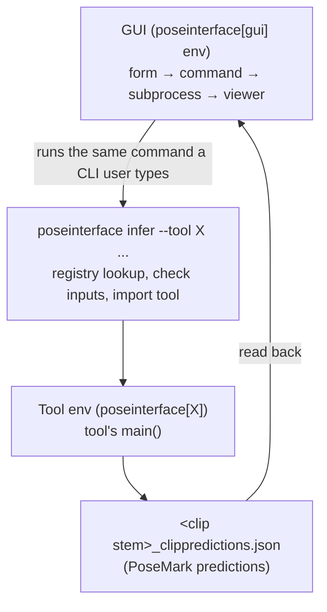

# Proposal for a `poseinterface infer` command that runs each tool in its own environment

## Description

Add a `poseinterface infer --tool <tool>` command to the main package.

The command does not install the tool into the user's environment.
It asks uv to build a separate, throwaway environment for that tool and runs the tool's
`infer.py` inside it.

A user then needs one line and no clone:

```bash
uvx poseinterface infer --tool cotracker3 --video clip.mp4 --startlabels clip_startlabels.json
```

The only thing the user installs is uv.

- `uvx` downloads `poseinterface` from PyPI into a temporary environment that uv caches.
    - That main env gets the `[project] dependencies` of the root `pyproject.toml`.
    - It is not locked: `uvx` picks the newest versions that fit those ranges.
- The dispatcher creates the tool env on top of the main env, so it uses the same
  `poseinterface`, plus torch and the other packages pinned in the tool's `uv.lock`.

# Proposal 1: using layered environments -- rejected

We decided against layered environments because their dependencies are not fully resolved.
See PR 91 [comment 1](https://github.com/neuroinformatics-unit/poseinterface/pull/91#issuecomment-6770441920) and [comment 2](https://github.com/neuroinformatics-unit/poseinterface/pull/91#issuecomment-6801367879) for the detailed discussion.

# Proposal 2: one optional-dependency set per tool

Instead of a separate `uv.lock` per tool and a layered tool env, each tool's dependencies
become an extra in the root `pyproject.toml`:

```toml
[project.optional-dependencies]
cotracker3 = ["torch>=2.14.1"]
dlc = ["deeplabcut..."]
lp = ["lightning-pose..."]
gui = ["marimo", "opencv-python-headless", "matplotlib"]
```

Tool names and version ranges are placeholders. The tool code lives inside the package
(`poseinterface/tools/<tool>/infer.py`), and `cli.py` imports it lazily, so the main package
never imports a tool's dependencies (e.g. `torch`). In stage 1 (below), `cli.py` does not
install anything: the user picks the extra in the command.

Two kinds of tool share the same command:

- **Point trackers** (e.g. CoTracker3) take `--video` and `--startlabels`, and subclass
  `PointTracker` ([#91](https://github.com/neuroinformatics-unit/poseinterface/pull/91)).
- **Pose estimators** (e.g. DeepLabCut, Lightning Pose) take `--video` and `--model`, and
  subclass a future `PoseEstimator`.

Both always write PoseMark predictions.

> [!IMPORTANT]
> * We decided to only support PoseMark predictions for now, and leave the PoseMark annotation support for when we deal with proofreading.
> * PoseMark predictions format is [cliplabels format](https://poseinterface.neuroinformatics.dev/posemark.html#clip-labels-cliplabels-json) with keypoint-level confidence, AND consistent identities across frames (potentially adding a new field for each `annotation` that is `individual_id`, and a set of individuals under `individuals`).
> See [this github comment](https://github.com/neuroinformatics-unit/poseinterface/issues/93#issuecomment-6920459550).


## Two interfaces: CLI and GUI

The CLI does all the work. The GUI is a light layer on top of it.



### CLI

```bash
# Users (stage 1): one isolated, cached env per extra
uvx --from 'poseinterface[dlc]' poseinterface infer --tool dlc --video clip.mp4 --model config.yaml
uvx --from 'poseinterface[cotracker3]' poseinterface infer --tool cotracker3 \
    --video clip.mp4 --startlabels clip_startlabels.json

# Before a PyPI release includes this (not tested)
uvx --from 'poseinterface[cotracker3] @ git+https://github.com/neuroinformatics-unit/poseinterface@<branch-or-tag>' \
    poseinterface infer --tool cotracker3 ...

# Developers, in a clone (poseinterface is installed editable)
uv run --extra cotracker3 poseinterface infer --tool cotracker3 ...

# Developers who switch tools often: one venv per tool, still locked and editable
UV_PROJECT_ENVIRONMENT=.venv-cotracker3 uv run --extra cotracker3 poseinterface infer --tool cotracker3 ...
```

`poseinterface infer`:

1. Looks up `--tool` in the [tool registry](#tool-registry-and-input-checks).
2. Checks every path input (`check_input`) and exits with all problems at once.
3. Imports the tool module and passes the remaining arguments to its own `parse_args`.

Steps 1 and 2 never import tool code, so a bad path fails fast, and the GUI can reuse them.

### GUI

A marimo app in `poseinterface/app/inference.py`, launched with `poseinterface app` (which runs
`marimo run` on the file, found with `importlib.resources`). Users install it with
`poseinterface[app]`. The folder and command are named `app`, not `apps`, so that the two
interfaces read as a pair (`cli.py`, `app/`), and more apps can be added to the folder later
(`poseinterface app <app>`).

The GUI:

1. Shows a form: the tool toggle and that tool's inputs, both built from the [tool registry](#tool-registry-and-input-checks).
2. Enables Run once every required field has a value. On click, it checks all inputs with
   `check_input`, then either lists every problem or builds the `infer` command, shows it (so
   users can copy it to the CLI) and runs it in a subprocess. Run is disabled while a run is in
   progress.
3. Streams the subprocess output into a log pane, since the first run of each tool downloads
   its dependencies and model weights.
4. Reads the PoseMark predictions file and shows the viewer, traces and per-keypoint
   confidence.

Rules:

- The GUI imports only poseinterface modules that do not import a tool's dependencies: the
  registry, `check_input`, `build_infer_command` and `poseinterface.io`. It never imports
  `poseinterface.tools.<tool>.infer`.
- Nothing in the package imports the GUI module. It is only launched by path, so
  `import poseinterface` does not need marimo.
- The subprocess command is built by the same `build_infer_command` the CLI documentation and
  tests use. In stage 1 it pins the tool env to the GUI's own poseinterface:
    - installed from PyPI: `uvx --from 'poseinterface[<tool>]==<__version__>' ...`;
    - running from a clone (editable install): `uvx --from '<repo path>[<tool>]' ...`.

  Other install types (git, wheel file) are not supported by the GUI in stage 1.

The current app ([#92](https://github.com/neuroinformatics-unit/poseinterface/pull/92)) imports
DeepLabCut and Lightning Pose inside its inference cell. Until `infer` supports them, running
inference from the GUI needs one of them installed in the GUI's env. The GUI catches the
`ImportError` and says what to install. Loading existing predictions works without them.

## Tool registry and input checks

A table of plain values in `poseinterface/tools/__init__.py`, readable without importing any
tool:

```python
@dataclass(frozen=True)
class Input:
    flag: str  # "--model"
    kind: Literal["file", "dir"]
    suffixes: tuple[str, ...] = ()  # allowed file extensions, empty = any
    hint: str = ""  # shown in the GUI and in error messages


@dataclass(frozen=True)
class Tool:
    module: str  # imported only inside the tool's env
    kind: Literal["tracker", "estimator"]
    inputs: tuple[Input, ...]
    label: str = ""  # GUI display name
    extra: str = ""  # pyproject extra, defaults to the tool name


VIDEO = Input(
    "--video", "file", (".mp4", ".avi", ".mov"), "the video to run on"
)

TOOLS = {
    "cotracker3": Tool(
        "poseinterface.tools.cotracker3.infer",
        "tracker",
        (VIDEO, Input("--startlabels", "file", (".json",))),
        "CoTracker3",
    ),
    "dlc": Tool(
        "poseinterface.tools.dlc.infer",
        "estimator",
        (
            VIDEO,
            Input(
                "--model",
                "file",
                (".yaml", ".yml"),
                "the project's config.yaml",
            ),
        ),
        "DeepLabCut",
    ),
    "lp": Tool(
        "poseinterface.tools.lp.infer",
        "estimator",
        (VIDEO, Input("--model", "dir", (), "a trained model folder")),
        "Lightning Pose",
    ),
}
```

`check_input(inp, path) -> str | None` returns a problem description or `None`:

- Files use `movement.validators.files.validate_file_path(path, suffixes=...)`, which checks
  that the path exists, is not a directory, is readable and has an allowed suffix. It logs each
  failure through movement's logger, which is fine because both the CLI and the GUI check once
  per run. Check it is in movement's public API before relying on it.
- Folders (e.g. a Lightning Pose model) use `path.is_dir()`, because `validate_file_path`
  rejects directories.

These checks are deliberately cheap. Deeper checks (is this a valid DLC project, does the
checkpoint load) need the tool installed, so they stay in the tool's own `parse_args` / `main`.

Options that the GUI does not need to collect (e.g. `--device`, batch size) stay in each tool's
`parse_args`, as today.

## Output: PoseMark predictions

Every tool writes `<clip stem>_clippredictions.json` in the PoseMark predictions format
proposed in [#93 - issue comment](https://github.com/neuroinformatics-unit/poseinterface/issues/93#issuecomment-6920459550).

The PoseMark predictions format is [cliplabels format](https://poseinterface.neuroinformatics.dev/posemark.html#clip-labels-cliplabels-json) with keypoint-level confidence, AND consistent identities across frames (potentially adding a new field for each `annotation` that is `individual_id`, and a set of individuals under `individuals`).

- Point trackers write it from their arrays, through a shared writer in `poseinterface.io`.
- Pose estimators keep their own output file (e.g. DLC/LP CSV) and also write PoseMark
  predictions, by loading their output with `movement` and calling the same writer.
- The GUI and tool comparisons read only COCO keypoint results (i.e. predictions), with `movement.load_poses.from_coco_file` (movement >= 0.18.0). That loader currently keeps only `score`, not per-keypoint confidence (see #93).


## Hiding `uvx` from users

Users install poseinterface from PyPI and call its CLI in one go with `uvx`. E.g., users should be able to do something like:

```bash
uvx poseinterface[cotracker3] infer --tool cotracker3 --video /path/to/video --startlabels /path/to/startlabels/json --device gpu
uvx poseinterface gui
```
> [!IMPORTANT]
> `uvx` can pick up that the name of the main command is the same as the name of the package if we don't use the `--from` flag.
> So we can do:
> ```
> uvx poseinterface[cotracker3] infer --tool cotracker3 --video /path/to/video --startlabels /path/to/startlabels/json
> ```
> But this won't work:
> ```
> uvx --from poseinterface[cotracker3] infer --tool cotracker3 --video /path/to/video --startlabels /path/to/startlabels/json
> ```

When the tool's module cannot be imported, `cli.py` re-runs itself in the tool's env:

```python
try:
    module = importlib.import_module(TOOLS[tool].module)
except ImportError:
    if os.environ.get(
        "POSEINTERFACE_REEXEC"
    ):  # already inside the tool env: real error
        raise
    print(
        f"Setting up the {tool} environment (first run downloads its dependencies)..."
    )
    cmd = [
        "uvx",
        "--from",
        f"poseinterface[{tool}]=={__version__}",
        "poseinterface",
        "infer",
        "--tool",
        tool,
        *tool_argv,
    ]
    sys.exit(
        subprocess.run(
            cmd, env={**os.environ, "POSEINTERFACE_REEXEC": "1"}
        ).returncode
    )
```

- Inputs are checked before this import, so a bad path still fails before any install.
- Developers never take this path: `uv run --extra <tool>` has the tool installed.
- Only PyPI installs re-exec. Other install types without the extra get a clear error that
  names the extra to install, instead of rebuilding their source as proposal 1 had to.
- The tools do not change, and the tool env is a normal `uvx` env, so `--torch-backend` stays
  available (as a passthrough option).
- The GUI's subprocess call becomes plain `poseinterface infer ...`. Nothing else in the GUI
  changes.

A variant where `poseinterface infer` always builds the tool env itself, layered on the calling
env (as in proposal 1, with the extra's requirements read from the installed metadata), was
considered. It brings back layering, the choice of which `poseinterface` the tool env gets, and
the loss of `--torch-backend`, in exchange for removing an `ImportError` path. Rejected.

## How isolation works

- `uvx` runs tools "in temporary, isolated environments", and `--from` accepts extras
  (`uvx --from 'mypy[faster-cache,reports]' mypy ...`):
  [uv tools guide](https://docs.astral.sh/uv/guides/tools/).
- Each distinct requirement (`poseinterface[cotracker3]`, `poseinterface[dlc]`) gets its own
  cached env, so tools with incompatible dependencies never share an env. The guide above does
  not state the per-requirement caching explicitly; see
  [uv tools concepts](https://docs.astral.sh/uv/concepts/tools/).
- In a clone it is different: "uv resolves all project dependencies together, including
  optional dependencies ('extras')"
  ([project config](https://docs.astral.sh/uv/concepts/projects/config/)).
    - If two tools' extras are incompatible, locking fails until they are declared under
      `[tool.uv] conflicts = [[{ extra = "dlc" }, { extra = "lp" }]]`.
    - There is one `.venv` by default. `uv run --extra <tool>` syncs it to that extra, so
      switching tool re-syncs it. `UV_PROJECT_ENVIRONMENT` gives each tool its own venv.

## Dependency groups

Following movement, which does the same for its napari GUI:

- `dev` includes `"poseinterface[gui]"`, so developers get the GUI with `uv sync`.
- Tool extras stay out of `dev` (and there is no `all` extra), so they never have to install
  into one env.

## What this removes from proposal 1

- Moving `envs/` into the package as tool folders with their own `pyproject.toml` and `uv.lock`
  (proposal 1, sections 1 and 2).
- The `uv export` step, the layered `uv run --no-project` env, and the `MIN_UV_VERSION` check
  (proposal 1, sections 3 and 4).
- The broken `../../..` path gotcha, and the drift between the main env's and the tool env's
  `poseinterface`: the tool runs in the same env as the `poseinterface` that dispatches it.
- In stage 1, `cli.py` does not call uv. In stage 2, it calls `uvx` only when the tool is
  missing.

## Trade-offs

| Detail | Consequence | Handling |
|---|---|---|
| `uvx` does not read the repo's `uv.lock` | Users get the newest versions within the extra's ranges, not the versions developers tested (the main env already works this way) | Tighter ranges or upper bounds on fragile dependencies (e.g. `torch`) |
| All extras resolve together in the dev lockfile | Incompatible tools fail to lock | `[tool.uv] conflicts`, one entry per incompatible pair |
| The user runs `poseinterface infer --tool X` without extra `X` installed | Stage 1: the lazy import fails | Stage 1: catch `ImportError` and print the matching `uvx --from 'poseinterface[X]' ...` command. Stage 2: re-exec through `uvx` |
| The tool name appears twice in stage 1 (`[dlc]` and `--tool dlc`) | Slightly redundant command | Removed in stage 2 |
| Stage 2 needs uv at runtime and starts an install the user did not type | Surprise downloads, or a failure if uv is missing | Print what is being installed; name the uv install page in the error |
| First run of a tool installs its env before the tool parses its arguments | A typo in a path could surface only after minutes of installing | `check_input` runs in the CLI before the tool import, and in the GUI on click |
| The GUI's poseinterface must match the tool env's | Different `PointTracker` / writer code between GUI and tool | Pin `==__version__`, or the repo path for an editable install |
| Until `infer` supports DLC and LP, the GUI imports them directly | Running inference from the GUI needs them in the GUI's env | Catch `ImportError` and say what to install; loading existing predictions still works |
| Every tool's dependencies are listed in the main package's metadata | `pip install poseinterface[all]`-style installs could pull conflicting tools | Do not offer an `all` extra |
| PyTorch build per platform (proposal 1, point 3) | Unlike `uv run`, `uvx` has a `--torch-backend` flag (`auto`, `cpu`, `cu1xx`, `rocm…`; checked with `uv tool run --help`, uv 0.13.6) | Users can add `--torch-backend auto` to the `uvx` command. Not tested on a GPU machine |

This also changes one row of proposal 1's Rejected alternatives table: "Install every tool into
the main env as optional extras" was rejected for dependency conflicts. That holds when the
extras share one env, but not when each extra runs in its own `uvx` env.
